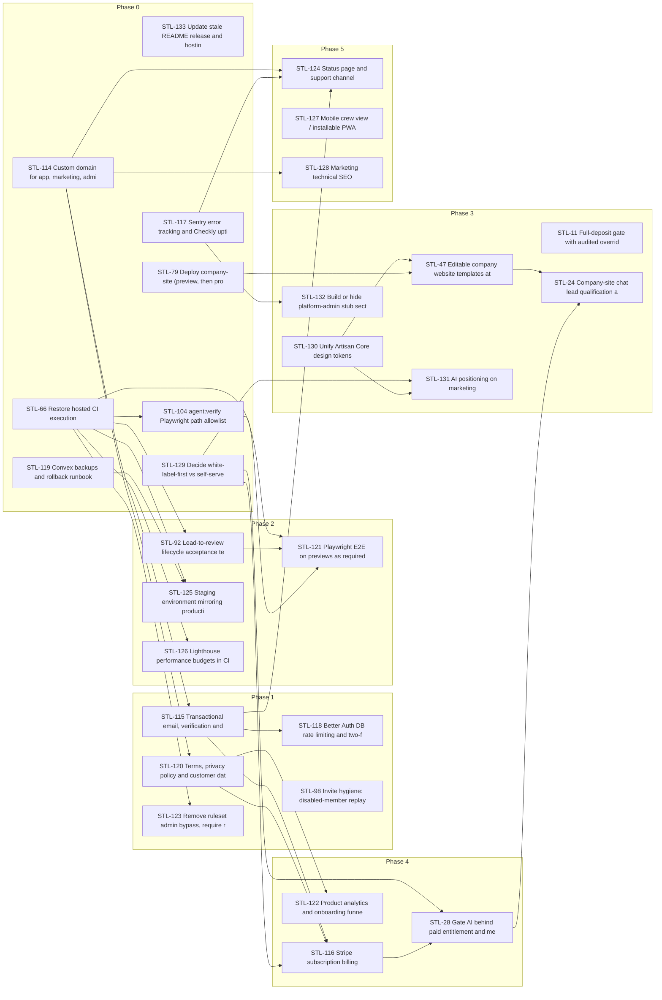

# Painter OS launch roadmap

Issue-by-issue plan to take Painter OS from today's state to a launchable product. Each issue has a factory contract in [`.factory/contracts/`](../../.factory/contracts/README.md). Linear (ASDLC › Painter OS) is the source of truth for status; this file is the order and the boundaries.

Legend — **Size:** S ≤1 day, M 2–4 days, L 1–2 weeks of agent work. **Owner:** `agent` = any coding agent under its contract; Johnny-only steps are called out explicitly. **Factory:** ✅ can run on a `factory/` branch; ⚠️ needs a maintainer (non-factory) PR because it touches guard-protected paths (`.github/**`, `scripts/**`) or GitHub settings.

**Sequencing decision (STL-129, Johnny, 2026-10-13): both — white-label first, then self-serve SaaS.** Launch 1 is operator-provisioned white-label for Sky's the Limit (Phases 0–3, 5). Phase 4 monetization (STL-116 Stripe, STL-28 AI entitlements) and STL-131 AI/pricing positioning happen **after** the white-label launch, as the self-serve SaaS step.

White-label launch critical path: STL-66 → STL-114 → STL-115 → STL-118/STL-120. Self-serve path afterward: STL-116 → STL-28. Everything else can run in parallel once its blockers clear.

## Dependency graph

## Phase 0 — Foundations (CI, decision, domain, monitoring, backups)

| Issue | GH | Goal | Depends on | Size | Owner | Risk | Factory | Contract |
|---|---|---|---|---|---|---|---|---|
| [STL-66](https://linear.app/johnny-cage/issue/STL-66) Restore hosted CI execution | #158 | Get GitHub Actions jobs starting again so CI and Agent readiness run on every PR, and record proof. | — | S | Johnny (GitHub billing) + agent evidence | low | ✅ | [`STL-66.json`](../../.factory/contracts/STL-66.json) |
| [STL-133](https://linear.app/johnny-cage/issue/STL-133) Update stale README release and hosting status | #245 | Make README describe the four apps, current gated deploy path and the launch roadmap, and mark old release text historical. | — | S | agent | low | ✅ | [`STL-133.json`](../../.factory/contracts/STL-133.json) |
| [STL-129](https://linear.app/johnny-cage/issue/STL-129) Decide white-label-first vs self-serve SaaS sequencing | #241 | Record Johnny's launch-sequencing decision and re-sequence billing/entitlement work in the roadmap. | — | S | Johnny decision, agent records it | low | ✅ | [`STL-129.json`](../../.factory/contracts/STL-129.json) |
| [STL-104](https://linear.app/johnny-cage/issue/STL-104) agent:verify Playwright path allowlist and root failure | #213 | Allowlist PLAYWRIGHT_BROWSERS_PATH in agent:verify and fail with a clear message when run as root. | STL-66 | S | maintainer (scripts/** is guard-protected) | low | ⚠️ | [`STL-104.json`](../../.factory/contracts/STL-104.json) |
| [STL-79](https://linear.app/johnny-cage/issue/STL-79) Deploy company-site (preview, then production) | #172 | Get apps/company-site building and deployed on Vercel preview, with a production promotion awaiting Johnny's approval. | — | S | agent; Johnny approves production | low | ✅ | [`STL-79.json`](../../.factory/contracts/STL-79.json) |
| [STL-114](https://linear.app/johnny-cage/issue/STL-114) Custom domain for app, marketing, admin and company sites | #226 | Move all four apps from *.vercel.app to the owned launch domain with auth origins and site URLs updated per environment. | — | M | Johnny (buy domain, DNS) + agent (config) | high | ✅ | [`STL-114.json`](../../.factory/contracts/STL-114.json) |
| [STL-117](https://linear.app/johnny-cage/issue/STL-117) Sentry error tracking and Checkly uptime monitoring | #229 | Report errors from all four Next apps and Convex to Sentry with releases, and run Checkly checks on sign-in and core flows. | — | M | agent; Johnny routes alerts to phone | high | ✅ | [`STL-117.json`](../../.factory/contracts/STL-117.json) |
| [STL-119](https://linear.app/johnny-cage/issue/STL-119) Convex backups and rollback runbook | #231 | Enable scheduled production Convex backups, rehearse one restore into non-prod, and document rollback. | — | S | Johnny enables backups; agent writes runbook | low | ✅ | [`STL-119.json`](../../.factory/contracts/STL-119.json) |

## Phase 1 — Auth, email and trust

| Issue | GH | Goal | Depends on | Size | Owner | Risk | Factory | Contract |
|---|---|---|---|---|---|---|---|---|
| [STL-115](https://linear.app/johnny-cage/issue/STL-115) Transactional email, verification and password reset | #227 | Turn on real delivery for the Better Auth callbacks: verification required at sign-up, password reset and invites. | STL-114 | M | agent; Johnny picks provider and adds DNS | high | ✅ | [`STL-115.json`](../../.factory/contracts/STL-115.json) |
| [STL-118](https://linear.app/johnny-cage/issue/STL-118) Better Auth DB rate limiting and two-factor | #230 | Add database-backed Better Auth rate limiting with the real client IP, and two-factor for owners (required for platform-admin). | STL-115 | M | agent | high | ✅ | [`STL-118.json`](../../.factory/contracts/STL-118.json) |
| [STL-98](https://linear.app/johnny-cage/issue/STL-98) Invite hygiene: disabled-member replay and error codes | #204 | Reject invitation replay by disabled members and split INVITE_INVALID into specific error codes. | — | S | agent | high | ✅ | [`STL-98.json`](../../.factory/contracts/STL-98.json) |
| [STL-120](https://linear.app/johnny-cage/issue/STL-120) Terms, privacy policy and customer data deletion | #232 | Publish Terms and Privacy on marketing, link at sign-up, and give owners audited data export and deletion. | STL-114 | M | agent drafts; Johnny/legal review | high | ✅ | [`STL-120.json`](../../.factory/contracts/STL-120.json) |
| [STL-123](https://linear.app/johnny-cage/issue/STL-123) Remove ruleset admin bypass, require review on backend | #235 | Remove admin bypass from the main ruleset and require one approving review with CODEOWNERS for backend. | STL-66 | S | Johnny/maintainer (GitHub settings, .github/CODEOWNERS) | low | ⚠️ | [`STL-123.json`](../../.factory/contracts/STL-123.json) |

## Phase 2 — Quality gates

| Issue | GH | Goal | Depends on | Size | Owner | Risk | Factory | Contract |
|---|---|---|---|---|---|---|---|---|
| [STL-92](https://linear.app/johnny-cage/issue/STL-92) Lead-to-review lifecycle acceptance test on a fixed SHA | #189 | One acceptance test covering lead -> estimate -> approval -> deposit -> job -> invoice -> payment -> review on a fixed SHA. | STL-66 | M | agent | low | ✅ | [`STL-92.json`](../../.factory/contracts/STL-92.json) |
| [STL-121](https://linear.app/johnny-cage/issue/STL-121) Playwright E2E on previews as required checks | #233 | Playwright suite for sign-up, estimate, job and invoice running against Vercel previews. | STL-66, STL-92, STL-104 | M | agent; maintainer wires workflow | low | ✅ | [`STL-121.json`](../../.factory/contracts/STL-121.json) |
| [STL-125](https://linear.app/johnny-cage/issue/STL-125) Staging environment mirroring production | #237 | A staging Vercel environment with a dedicated Convex deployment, used to rehearse migrations before prod. | STL-66, STL-119 | M | agent; Johnny approves new Convex deployment | low | ✅ | [`STL-125.json`](../../.factory/contracts/STL-125.json) |
| [STL-126](https://linear.app/johnny-cage/issue/STL-126) Lighthouse performance budgets in CI | #238 | Lighthouse CI budgets for LCP/CLS/TBT and bundle size on marketing and key app pages. | STL-66 | S | agent; maintainer wires workflow | low | ✅ | [`STL-126.json`](../../.factory/contracts/STL-126.json) |

## Phase 3 — Product and brand

| Issue | GH | Goal | Depends on | Size | Owner | Risk | Factory | Contract |
|---|---|---|---|---|---|---|---|---|
| [STL-130](https://linear.app/johnny-cage/issue/STL-130) Unify Artisan Core design tokens | #242 | One shared Artisan Core token source used by the app, marketing and company templates. | — | M | agent | low | ✅ | [`STL-130.json`](../../.factory/contracts/STL-130.json) |
| [STL-47](https://linear.app/johnny-cage/issue/STL-47) Editable company website templates at marketing quality | #120 | Studio, Editorial and Direct templates at Painter OS marketing quality, with editable logo, photos, reviews, blog, pricing and contact info. | STL-130, STL-79 | L | agent | high | ✅ | [`STL-47.json`](../../.factory/contracts/STL-47.json) |
| [STL-131](https://linear.app/johnny-cage/issue/STL-131) AI positioning on marketing | #243 | Add an AI section and AI features page to the marketing site describing only real or clearly-labeled upcoming features. | STL-129, STL-130 | S | agent; Johnny approves claims | low | ✅ | [`STL-131.json`](../../.factory/contracts/STL-131.json) |
| [STL-132](https://linear.app/johnny-cage/issue/STL-132) Build or hide platform-admin stub sections | #244 | Hide or clearly label unimplemented platform-admin sections; add read-only sites and health views. | STL-117 | S | agent | low | ✅ | [`STL-132.json`](../../.factory/contracts/STL-132.json) |
| [STL-11](https://linear.app/johnny-cage/issue/STL-11) Full-deposit gate with audited override | #57 | Require full deposit before scheduling/starting a job, with audited owner/office-admin override. | — | M | agent | high | ✅ | [`STL-11.json`](../../.factory/contracts/STL-11.json) |
| [STL-24](https://linear.app/johnny-cage/issue/STL-24) Company-site chat lead qualification and estimate booking | #78 | Chatbot on company sites that qualifies leads and books verified estimate visits without inventing prices. | STL-47, STL-28 | L | agent | high | ✅ | [`STL-24.json`](../../.factory/contracts/STL-24.json) |

## Phase 4 — Monetization (post-white-label launch, self-serve SaaS)

Starts only after the white-label launch is live for Sky's the Limit. STL-131 (Phase 3 table) also ships with this phase.

| Issue | GH | Goal | Depends on | Size | Owner | Risk | Factory | Contract |
|---|---|---|---|---|---|---|---|---|
| [STL-116](https://linear.app/johnny-cage/issue/STL-116) Stripe subscription billing | #228 | Stripe subscriptions with trial, customer portal and webhooks that drive company entitlements. | STL-129, STL-115, STL-120 | L | agent; Johnny creates Stripe account/products | high | ✅ | [`STL-116.json`](../../.factory/contracts/STL-116.json) |
| [STL-28](https://linear.app/johnny-cage/issue/STL-28) Gate AI behind paid entitlement and metered usage | #83 | Paid company entitlement gates AI features; usage metered and bounded. | STL-129, STL-116 | M | agent | high | ✅ | [`STL-28.json`](../../.factory/contracts/STL-28.json) |
| [STL-122](https://linear.app/johnny-cage/issue/STL-122) Product analytics and onboarding funnel | #234 | Consent-aware analytics with key funnel events and an onboarding checklist. | STL-120 | M | agent | low | ✅ | [`STL-122.json`](../../.factory/contracts/STL-122.json) |

## Phase 5 — Launch polish

| Issue | GH | Goal | Depends on | Size | Owner | Risk | Factory | Contract |
|---|---|---|---|---|---|---|---|---|
| [STL-124](https://linear.app/johnny-cage/issue/STL-124) Status page and support channel | #236 | Public status page fed by uptime checks and support links in app and marketing. | STL-114, STL-117, STL-115 | S | Johnny (support inbox) + agent | low | ✅ | [`STL-124.json`](../../.factory/contracts/STL-124.json) |
| [STL-127](https://linear.app/johnny-cage/issue/STL-127) Mobile crew view / installable PWA | #239 | Mobile-first crew view with manifest and service worker. | — | M | agent | low | ✅ | [`STL-127.json`](../../.factory/contracts/STL-127.json) |
| [STL-128](https://linear.app/johnny-cage/issue/STL-128) Marketing technical SEO | #240 | Sitemap, robots, JSON-LD and OG images for the marketing site. | STL-114 | S | agent; Johnny submits Search Console | low | ✅ | [`STL-128.json`](../../.factory/contracts/STL-128.json) |

## Johnny-only steps

- **STL-66:** fix GitHub Actions billing/spending limit (Settings → Billing & plans).
- **STL-129:** ✅ decided 2026-10-13 — white-label first, then self-serve SaaS.
- **STL-114:** buy the launch domain and approve DNS.
- **STL-115:** pick email provider (Resend or AgentMail); approve SPF/DKIM/DMARC records.
- **STL-116:** create Stripe account, products and prices; approve live mode.
- **STL-119:** approve enabling production Convex backups.
- **STL-120:** review legal text before publish.
- **STL-123:** remove ruleset admin bypass (GitHub settings).
- **STL-125:** approve a new paid Convex staging deployment.
- **STL-127/128:** real-phone check; Search Console submission.
- **All:** every production deploy, prod env var change and schema migration needs explicit approval.

## Not in this roadmap

Prospect pipeline (M1–M8), CRM migration (STL-59/69), Zapier (STL-21/22), research spikes (STL-19/32/34), and read-limit hardening (STL-67/96/102/105) stay tracked in Linear but are not launch blockers.
